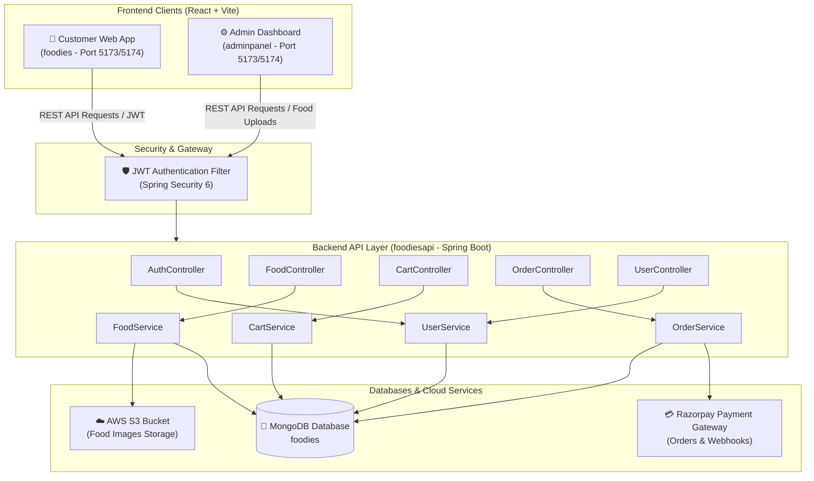
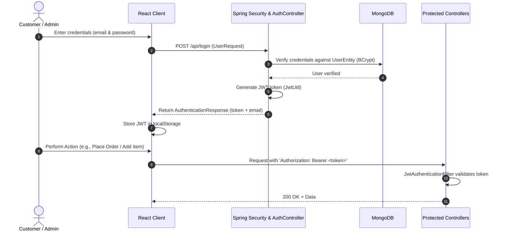
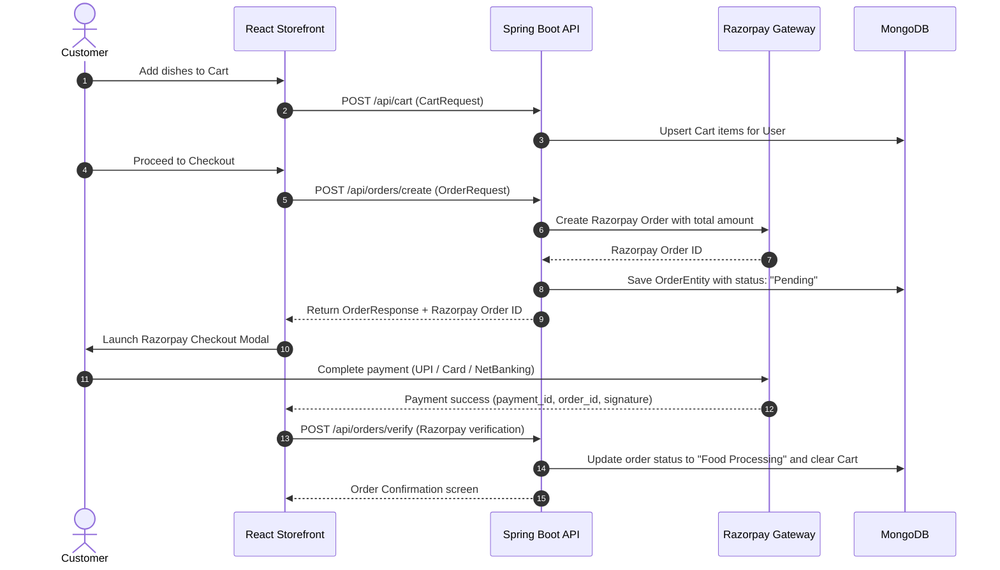

# 🍔 Foodies - Full-Stack Online Food Delivery Platform

[](https://spring.io/projects/spring-boot)
[](https://react.dev/)
[](https://www.mongodb.com/)
[](https://aws.amazon.com/s3/)
[](https://razorpay.com/)
[](https://opensource.org/licenses/MIT)

> **Developed & Maintained by:** [Gaurav Kalamkhede](https://github.com/gauravkal006)  
> **Repository:** [https://github.com/gauravkal006/online-food-delivery-project](https://github.com/gauravkal006/online-food-delivery-project)  
> **Contact:** [kalamkhedejanardhan@gmail.com](mailto:kalamkhedejanardhan@gmail.com)

---

## 📌 Project Overview

**Foodies** is an enterprise-grade, full-stack food delivery application built with modern web technologies. It provides a seamless end-to-end food ordering experience for customers and a comprehensive administrative dashboard for restaurant managers and operators.

The project is structured into three distinct decoupled modules:
1. **`foodies`**: React-based Customer Web Application (browsing, cart management, checkout with Razorpay, live order status).
2. **`adminpanel`**: React-based Admin Dashboard (menu management, food item uploads with image storage, order status transitions).
3. **`foodiesapi`**: Java Spring Boot 3 REST API backend backed by MongoDB, secured with stateless JWT token authentication, integrated with AWS S3 for media assets and Razorpay for payment order processing.

---

## 🏗️ System Architecture & Workflow

### 1. High-Level Architecture Diagram



---

### 2. Authentication & Authorization Flow



---

### 3. Food Ordering & Payment Lifecycle



---

## 🚀 Modules & Capabilities

### 1. Customer Application (`foodies`)
- **Interactive Menu**: Filter dishes by category (Salads, Rolls, Desserts, Sandwiches, Cakes, Pure Veg, Pasta, Noodles, etc.).
- **Dynamic Cart**: Real-time quantity adjustment, persistent cart synchronization with backend database.
- **Secure Checkout**: Delivery address capture and direct checkout with Razorpay payment modal.
- **Order History & Tracking**: Real-time order progress tracking ("Food Processing", "Out for Delivery", "Delivered").
- **Authentication**: Modal-based instant sign-in and user registration with JWT token management.

### 2. Admin Dashboard (`adminpanel`)
- **Menu Management**: Add new food items with name, price, description, category, and photo upload.
- **AWS S3 Integration**: Automatically streams uploaded food images to Amazon S3 buckets with generated public URLs.
- **Food Catalog**: View, search, and remove menu items dynamically.
- **Order Management Console**: View all customer orders, filter status, inspect ordered items, customer shipping details, and advance status through the delivery lifecycle.

### 3. Backend REST Service (`foodiesapi`)
- **Spring Boot 3.4.3** with Spring Web, Spring Data MongoDB, and Spring Security 6.
- **Stateless JWT Security**: Custom `JwtAuthenticationFilter` protecting API routes.
- **AWS S3 Storage Client**: Programmatic multipart file upload using AWS SDK.
- **Razorpay Integration**: Server-to-server order creation and payment verification.
- **Clean N-Tier Architecture**: Clean separation between Controllers, Services, Repositories, Entities, and DTOs (IO layer).

---

## 📁 Repository Structure

```
online-food-delivery-project/
├── adminpanel/                    # Admin React Frontend
│   ├── public/                    # Static assets
│   ├── src/                       # React source code (components, pages, services)
│   ├── index.html                 # HTML template
│   ├── package.json               # Node dependencies & metadata
│   └── vite.config.js             # Vite configuration
│
├── foodies/                       # Customer React Frontend
│   ├── public/                    # Static assets
│   ├── src/                       # React storefront components, context & state
│   ├── index.html                 # HTML template with Razorpay Checkout script
│   ├── package.json               # Node dependencies & metadata
│   └── vite.config.js             # Vite configuration
│
├── foodiesapi/                    # Spring Boot Backend API
│   ├── mvnw / mvnw.cmd            # Maven wrapper binaries
│   ├── pom.xml                    # Maven build dependencies & plugin config
│   └── src/
│       ├── main/
│       │   ├── java/com/gaurav/foodiesapi/
│       │   │   ├── config/        # AWS S3 & Spring Security configurations
│       │   │   ├── controller/    # REST API endpoints (Auth, Food, Cart, Order, User)
│       │   │   ├── entity/        # MongoDB document models (Food, User, Cart, Order)
│       │   │   ├── filters/       # JWT token verification filter
│       │   │   ├── io/            # Data transfer objects (Requests & Responses)
│       │   │   ├── repository/    # Spring Data MongoDB repositories
│       │   │   ├── service/       # Business logic implementations
│       │   │   └── util/          # JWT generation & validation utilities
│       │   └── resources/
│       │       └── application.properties # App configuration & credentials
│       └── test/                  # Automated unit and integration tests
│
├── food images/                   # Sample food image assets for testing
├── .gitignore                     # Git ignore rules
└── README.md                      # Comprehensive project documentation
```

---

## 🛠️ Technology Stack

| Layer | Technologies |
|---|---|
| **Customer Frontend** | React 18, Vite, Bootstrap 5, Bootstrap Icons, Axios, React Router 7, React Toastify, Razorpay Checkout |
| **Admin Dashboard** | React 19, Vite, Bootstrap 5, Bootstrap Icons, Axios, React Router 7, React Toastify |
| **Backend API** | Java 21, Spring Boot 3.4.3, Spring Security 6, Spring Data MongoDB, Lombok |
| **Database** | MongoDB (NoSQL) |
| **Cloud Storage** | Amazon Web Services (AWS) S3 |
| **Payments** | Razorpay Payment Gateway SDK |
| **Authentication** | JSON Web Tokens (JWT - io.jsonwebtoken 0.12.6) + BCrypt Password Encoder |

---

## ⚙️ Environment Configuration

Before running the application, configure your credentials in `foodiesapi/src/main/resources/application.properties` or set them as environment variables:

```properties
spring.application.name=foodiesapi

# MongoDB Configuration
spring.data.mongodb.uri=mongodb://localhost:27017/foodies

# AWS S3 Configuration (for food image uploads)
aws.access.key=${AWS_ACCESS_KEY:your_aws_access_key}
aws.secret.key=${AWS_SECRET_KEY:your_aws_secret_key}
aws.region=${AWS_REGION:us-east-1}
aws.s3.bucketname=${AWS_BUCKET_NAME:your_bucket_name}

# JWT Secret Key (HMAC-SHA256 string)
jwt.secret.key=${JWT_SECRET:your_secure_256_bit_jwt_secret_key_here}

# Razorpay Configuration
razorpay_key=${RAZORPAY_KEY:your_razorpay_key_id}
razorpay_secret=${RAZORPAY_SECRET:your_razorpay_key_secret}
```

---

## 🚀 Step-by-Step Getting Started

### Prerequisites
- **JDK 21** or later installed
- **Node.js** (v18+) and **npm** installed
- **MongoDB** running locally on port `27017` (or a MongoDB Atlas connection string)
- **AWS Account** with S3 Bucket permissions (optional for local testing without image upload)
- **Razorpay Test Account** for payment gateway test keys

---

### Step 1: Start MongoDB
Ensure MongoDB daemon is running locally:
```bash
mongod
```
*(Or use MongoDB Atlas by updating the `spring.data.mongodb.uri` connection string).*

---

### Step 2: Run the Backend API (`foodiesapi`)

```bash
cd foodiesapi

# Using Maven Wrapper (Windows):
.\mvnw.cmd spring-boot:run

# Using Maven Wrapper (macOS / Linux):
./mvnw spring-boot:run
```
The API server will start on `http://localhost:8080`.

---

### Step 3: Run the Admin Dashboard (`adminpanel`)

```bash
cd adminpanel

# Install dependencies:
npm install

# Start development server:
npm run dev
```
The Admin Panel will be accessible at `http://localhost:5173` (or the port specified by Vite).

---

### Step 4: Run the Customer App (`foodies`)

```bash
cd foodies

# Install dependencies:
npm install

# Start development server:
npm run dev
```
The Customer Storefront will be accessible at `http://localhost:5174` (or next available port).

---

## 📡 REST API Reference

### 🔐 Authentication (`/api`)
| Method | Endpoint | Description | Protected |
|---|---|---|---|
| `POST` | `/api/register` | Register a new user | No |
| `POST` | `/api/login` | Authenticate and obtain JWT token | No |

### 🍕 Food Management (`/api/foods`)
| Method | Endpoint | Description | Protected |
|---|---|---|---|
| `GET` | `/api/foods` | Fetch all food items | No |
| `GET` | `/api/foods/{id}` | Get food item details | No |
| `POST` | `/api/foods` | Add new food item with image upload (Admin) | No / JWT |
| `DELETE` | `/api/foods/{id}` | Delete a food item by ID | No / JWT |

### 🛒 Cart (`/api/cart`)
| Method | Endpoint | Description | Protected |
|---|---|---|---|
| `GET` | `/api/cart` | Get current logged-in user's cart | Yes (JWT) |
| `POST` | `/api/cart` | Add item or update quantity in cart | Yes (JWT) |
| `DELETE` | `/api/cart/{foodId}` | Remove specific item from cart | Yes (JWT) |
| `DELETE` | `/api/cart` | Clear entire cart | Yes (JWT) |

### 📦 Orders (`/api/orders`)
| Method | Endpoint | Description | Protected |
|---|---|---|---|
| `POST` | `/api/orders/create` | Initialize order and create Razorpay payment order | Yes (JWT) |
| `POST` | `/api/orders/verify` | Verify Razorpay payment signature & confirm order | Yes (JWT) |
| `GET` | `/api/orders/user` | Get all orders placed by the current user | Yes (JWT) |
| `GET` | `/api/orders/all` | Get all customer orders (Admin view) | Yes (JWT) |
| `PATCH` | `/api/orders/{id}/status` | Update order delivery status (Admin) | Yes (JWT) |

---

## 👨‍💻 Author & Credits

- **Project Lead & Developer:** [Gaurav Kalamkhede](https://github.com/gauravkal006)
- **GitHub:** [@gauravkal006](https://github.com/gauravkal006)
- **Email:** [kalamkhedejanardhan@gmail.com](mailto:kalamkhedejanardhan@gmail.com)

---

## 📄 License

This project is licensed under the terms of the [MIT License](LICENSE).
You are free to use, modify, and distribute this software with attribution.

